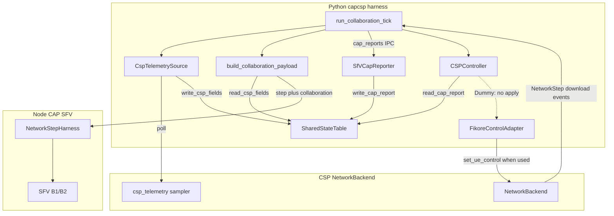

# Collaboration runtime (L0–L3 wiring)

The pilot separates **byte delivery** (opaque `NetworkStep` events) from **collaboration state** (what the CAP and the CSP may exchange under VQEG signaling). **All CAP–CSP collaboration in both directions goes through the shared table**: CSP telemetry is sampled from the backend beside the byte path and written to the table, read back for the CAP IPC snapshot; CAP reports are written after `cap_reports` IPC; a `CSPController` reads CAP state from the table at L3+. There is no parallel CAP–CSP path in the Node harness except consuming `step.collaboration` and emitting `cap_reports`.

Collaboration runs in the **Python harness** on the simulation clock. **`telemetry.jsonl`** is a separate flat diagnostic log for network KPIs; it does not replace the shared table.

B1/B2 rules do not yet consume `collaboration`; effective scheduler control uses a dummy `CSPController` today. Intended use of collaboration in policy and in FikoRE is described normatively in [`signaling.md`](signaling.md); open work is listed in the [implementation plan](implementation-plan.md).

**CAP** here means the application player process (Node.js SFV harness). **CSP** means the network backend (`mock` or FikoRE `transport_fikore`). Field definitions (`CspFields`, `CapReport`, L0–L4 rules) are in [`signaling.md`](signaling.md); this page focuses on **how the harness wires them**.

## What this layer does

| Direction | Mechanism | Consumed by policy today? |
|-----------|-----------|---------------------------|
| CSP → shared bus | `backend.csp_telemetry.poll()` (1 s by default) → `write_csp_fields` | No (audited + optional filtered view to CAP) |
| Bus → CAP | `step.collaboration` on `network_step` IPC | Stored via `applyCspUpdate`; B1/B2 decisions unchanged (`triggerDecision: false`) |
| CAP → shared bus | `cap_reports` IPC (pending reports only) → `write_cap_report` | No (audited; readable at L3+ by controller) |
| Bus → CSP control | `CSPController` → `BackendControlAdapter` | Only with a non-dummy controller that calls `apply` |

At **L0** (default configs), collaboration still **writes** the shared table for audit, but **read filters** hide CSP fields from the CAP and hide CAP reports from a controller. Scoring and session records stay the same as before this wiring.

## Signaling level vs information flow

Signaling level is an experiment knob (`signaling_level` in the JSON config). It does **not** swap the network backend or the SFV engine.

| Level | CSP writes to table | CAP receives in `collaboration.csp_by_ue` | CAP reports written | Controller reads CAP | Control toward CSP |
|-------|----------------------|-------------------------------------------|---------------------|----------------------|--------------------|
| L0 | yes (audit) | empty | yes (audit) | no | no |
| L1 | yes | plan rate (+ timestamp) | yes (audit) | no | no |
| L2 | yes | full `CspFields` (filtered) | yes (audit) | no | no |
| L3+ | yes | full `CspFields` | yes | yes | yes if `csp_controller` set |

Read filtering is implemented in `InMemorySharedStateTable.read_*` ([`capcsp/shared_state/table.py`](../capcsp/shared_state/table.py)). Writes always store the full payload; **`shared-state.jsonl`** records a row only when the stored CSP fields or CAP report **change** (same run holds the log file open for append).

## Components (Python harness)

| Component | Package | Role |
|-----------|---------|------|
| `SharedStateTable` | `capcsp/shared_state` | Per-UE `CspFields` and `CapReport`; JSONL audit |
| `run_collaboration_tick` (+ `bridge.run_sessions`) | `capcsp/collaboration/runtime.py`, `capcsp/player/bridge.py` | One collaboration tick per `NetworkBackend.advance()` |
| `CspTelemetrySource`, `CspTelemetryWriter` | `capcsp/collaboration/telemetry.py` | Backend-side sampler (`poll()`); the writer maps its samples into the table and `telemetry.jsonl`. `NoCspTelemetry` for backends without one (mock) |
| `build_collaboration_payload` | `capcsp/collaboration/snapshot.py` | Filtered CSP view for the CAP |
| `SfVCapReporter` | `capcsp/collaboration/cap_reporter.py` | Node `cap_reports` → table |
| `CSPController` | `capcsp/collaboration/csp_controller.py` | At L3+: read CAP from table, log control proposals |
| `DummyCSPController` | same | Proposals in `csp-control.jsonl`; never calls `BackendControlAdapter.apply` |
| `FikoreControlAdapter` | `capcsp/collaboration/adapters/fikore_control.py` | Maps `CspControlIntent` → `set_ue_control` (for future real controllers) |
| `NoOpControlAdapter` | `capcsp/collaboration/adapters/noop_control.py` | Baseline only on `mock` |

FikoRE-specific telemetry mapping: `capcsp/collaboration/adapters/fikore_mapper.py` (wraps `capcsp.shared_state.mapping`). The `sfv-reference-implementation` submodule exposes collaboration IPC hooks (`applyCspUpdate`, `drainCapReports`); B1/B2 policy use is still future work. The sampler itself is `fikore_transport.telemetry.NetworkTelemetrySampler` in `5g-network-emulator`; `TransportFikoreBackend` exposes it as `csp_telemetry`.

## Components (CAP / Node.js)

| Component | File | Role |
|-----------|------|------|
| `NetworkStepHarness` | `capcsp/player/js/network_step_harness.js` | Multi-UE steps, `applyCspUpdate` when a UE's CSP snapshot changes, `getCapReports` drains pending SFV reports |
| SFV engine | submodule | `applyCspUpdate`, `drainCapReports` (event-driven, ≤1 report/s per UE); `getCspFields()` on rules context; B1/B2 ignore CSP for now |

The Node process does **not** read or write the shared table. It only consumes `step.collaboration` and returns `cap_reports`; Python owns the table.

`NetworkStep` carries no telemetry; a backend that puts `NetworkTelemetryReceived` in a step is rejected. CAP-facing CSP data comes from `step.collaboration` only.

## Architecture (one simulation step)



Solid arrows are what runs on every configured run. The dashed arrow is the **intentional gap** for `DummyCSPController`: proposals are logged, but `FikoreControlAdapter.apply` is not called.

## Step tick (simulation clock)

One tick per `backend.advance()` ([`capcsp/collaboration/runtime.py`](../capcsp/collaboration/runtime.py)):

1. Serialize the step (`step_dict`) and validate download events.
2. `CspTelemetryWriter.poll_and_write` polls the backend's CSP telemetry source. When a sample is due (every `csp_telemetry_interval_s`, 1 s by default, and once more on the final step), it is mapped to `CspFields` and written to the table (**`shared-state.jsonl`**), and appended to **`telemetry.jsonl`**. The CAP therefore sees the sample in the same step.
3. Build `collaboration` from `read_csp_fields` per UE (signaling filter).
4. Send `network_step` to Node including `collaboration` (also logged in **`network-steps.jsonl`**). The harness calls `SFVSimulationController.applyCspUpdate` for each UE whose CSP snapshot changed; B1/B2 policy consumption is future work.
5. `SfVCapReporter.fetch_and_write` (separate `cap_reports` IPC) writes CAP→CSP rows **only for pending reports** drained from SFV (stall edges, video switches, buffer changes of 1.0 s or more, at most one per second per UE). The reply is often empty; after the final step the drain ignores the rate limit so terminal state is recorded.
6. If L3+ and `csp_controller: "dummy"`: `DummyCSPController.on_collaboration_tick` → **`csp-control.jsonl`** (`applied: false`).
7. If not final: apply player submit/cancel actions to **`NetworkBackend`** (byte path, unchanged).

Steps 4–6 run inside `run_collaboration_tick`; step 7 runs in `bridge.run_sessions` **after** the tick returns. Player actions therefore still occur **after** the Node step (and CAP reports) and **before** the next `advance()`, so request timing matches the original harness.

## IPC: `collaboration` on `network_step`

Python attaches an optional object to the step sent to Node (not part of the `NetworkBackend` API contract):

```json
{
  "time_s": 0.01,
  "events": [],
  "is_final": false,
  "collaboration": {
    "signaling_level": "L2",
    "csp_by_ue": {
      "0": {
        "updated_at_s": 0.01,
        "plan_downlink_mbps": null,
        "achieved_throughput_mbps": 1.2,
        "rtt_ms": 30.0,
        "loss_rate": 0.0,
        "congestion_rate": null
      }
    }
  }
}
```

At L0, `csp_by_ue` is `{}`. Python is the only place that applies signaling filters for this payload.

## Artifacts

| File | When |
|------|------|
| `shared-state.jsonl` | Every run (all signaling levels) |
| `csp-control.jsonl` | L3+ and `csp_controller: "dummy"` |
| `network-steps.jsonl` | Player-facing steps: download events + `collaboration` |
| `telemetry.jsonl` | Flat CSP telemetry samples, one row per UE every `csp_telemetry_interval_s` (empty on `mock`) |

### `csp-control.jsonl` row shape

- `record_type`: `"control_proposal"`
- `time_s`, `ue_id`, `signaling_level`
- `baseline`, `proposed` (`priority`, `max_downlink_mbps`)
- `applied` (always `false` for `DummyCSPController`)
- `reason` (e.g. `dummy_stall_boost`, `dummy_no_change`)

## Experiment configuration

| Key | Default | Meaning |
|-----|---------|---------|
| `signaling_level` | `L0` | See table above; full VQEG text in [`signaling.md`](signaling.md) |
| `plan_downlink_mbps_by_ue` | omitted | L1: inject plan into `CspFields` per UE id |
| `csp_controller` | omitted | `"dummy"` enables `DummyCSPController` at L3+ |
| `csp_baseline_control_by_ue` | omitted | Baseline `priority` / `max_downlink_mbps` for proposal logs |
| `clock_mode` | `"simulation"` | Only `"simulation"` is implemented today |

Example L3 wiring test: [`configs/experiments/collaboration/l3-dummy-mock.json`](../configs/experiments/collaboration/l3-dummy-mock.json).

## Run manifest (collaboration-related)

- `shared_state_log`, `csp_control_log` (filename or null)
- `clock_mode`, `cap_application` (`"sfv"`)

## Extending the design

| Goal | Approach |
|------|----------|
| Another CSP (e.g. netem) | New `NetworkBackend` (or a `Link` with `network_counters()` under `TransportBackend`) + `csp_telemetry` source + `BackendControlAdapter`; same table API |
| Another CAP (e.g. WebRTC) | New `CapReporter`; same `SharedStateTable` and JSONL grammar |
| SFV uses CSP hints | Submodule: `applyCspUpdate` from `step.collaboration`; harness calls engine only (no table in Node) |
| Effective FikoRE control | New `CSPController` implementation that calls `FikoreControlAdapter.apply` |
| Live / wall clock | New runtime driver; keep `time_s` and JSONL row shapes |

## Package layout

```text
capcsp/
  shared_state/       # table, types, telemetry → CspFields mapping
  collaboration/      # runtime, controllers, adapters, CapReporter
  player/             # Python bridge + js NetworkStep harness
```

Broader system context: [`architecture.md`](architecture.md). VQEG field semantics and L4: [`signaling.md`](signaling.md).
